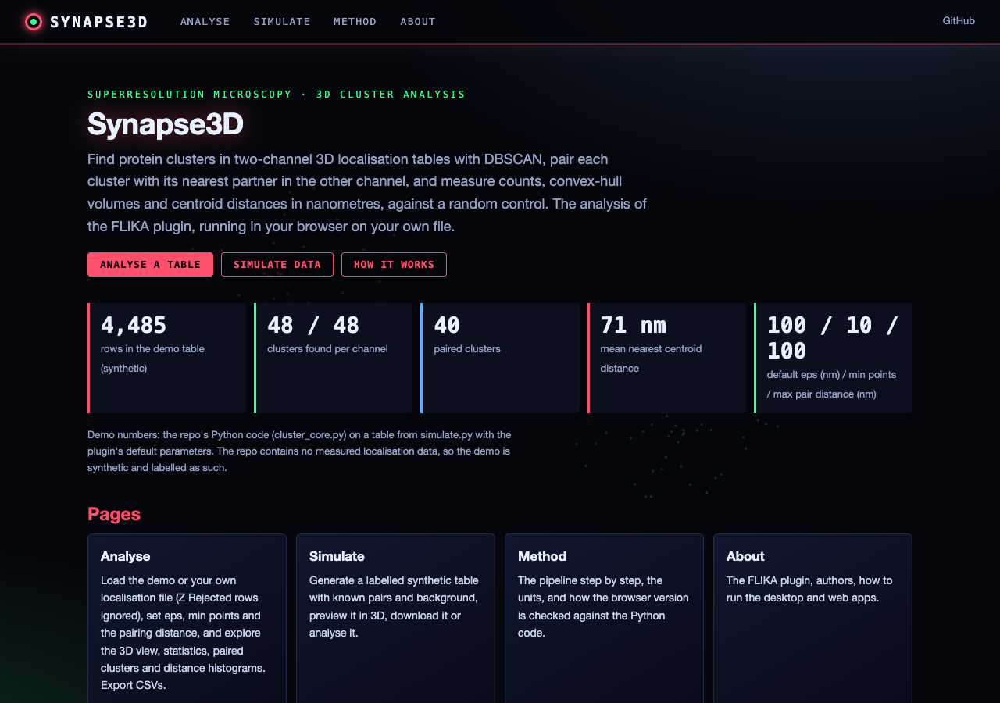
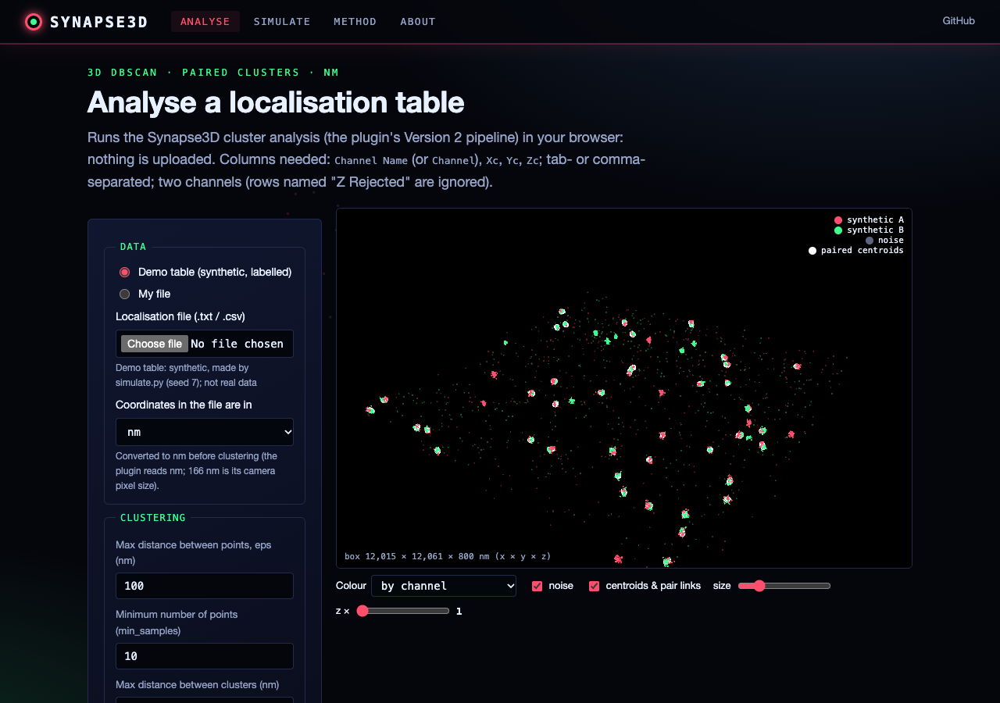
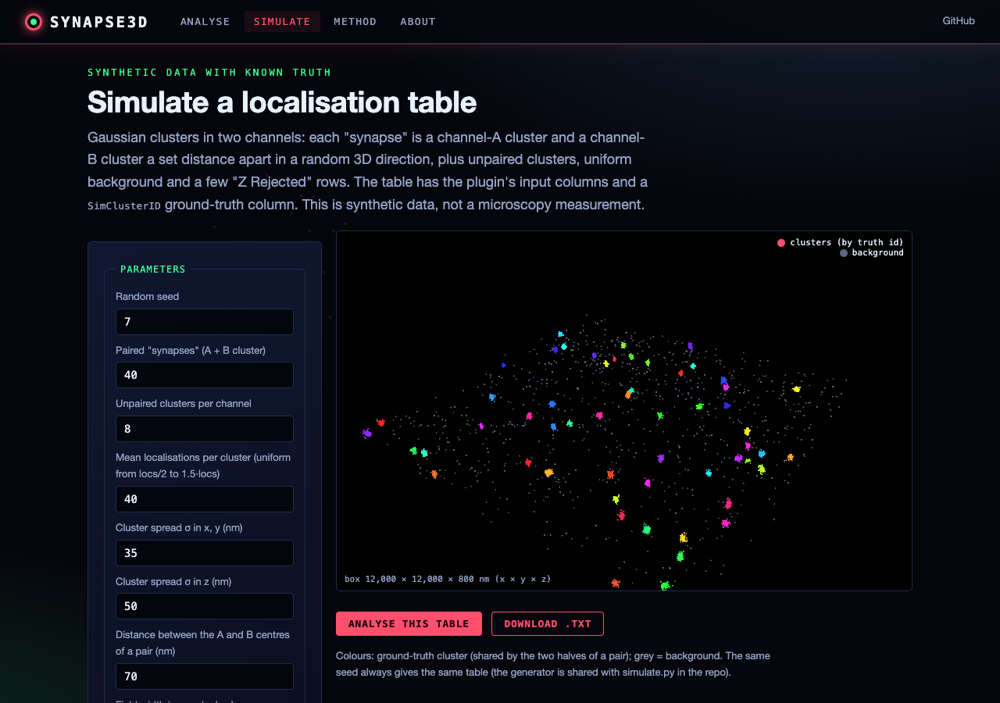

# Synapse3D

A FLIKA plugin for 3D cluster analysis of superresolution microscopy data, with a focus on synaptic protein organization.

## Overview

Synapse3D provides tools for analyzing the spatial organization and clustering of synaptic proteins using superresolution microscopy data. The plugin enables:

- 3D visualization and analysis of protein localizations
- DBSCAN-based cluster detection in 3D
- Analysis of spatial relationships between protein clusters
- Quantification of cluster properties (volume, density, etc.)
- Statistical analysis of cluster distributions
- Batch processing capabilities

## Features

- **3D Data Visualization**: Interactive 3D visualization of protein localizations and clusters
- **Cluster Detection**: DBSCAN-based clustering algorithm optimized for 3D protein distribution analysis
- **Dual Channel Analysis**: Compare and analyze relationships between two protein channels
- **ROI Analysis**: Define and analyze regions of interest in 2D and 3D
- **Statistical Tools**: Built-in tools for analyzing cluster distributions and spatial relationships
- **Batch Processing**: Process multiple datasets with consistent parameters
- **Data Export**: Export analysis results in CSV format for further processing

## Installation

### Requirements

- FLIKA (http://flika-org.github.io/)
- Python 3.x
- PyQt5
- numpy
- scipy
- scikit-learn
- pandas
- pyqtgraph

### Dependencies

The following Python packages are required:

```
numpy
scipy
pandas
scikit-learn
PyQt5
pyqtgraph
```

### Installing the Plugin

1. Install FLIKA following the instructions at http://flika-org.github.io/
2. Clone this repository:
```bash
git clone https://github.com/username/Synapse3D.git
```
3. Add the plugin directory to your FLIKA plugins folder

## Usage

### Basic Workflow

1. Launch FLIKA and enable the Synapse3D plugin
2. Load your localization data (supported format: .txt files with x,y,z coordinates)
3. Select analysis parameters:
   - Clustering distance (eps)
   - Minimum points per cluster (min_samples)
   - Maximum distance between clusters
4. Run cluster analysis
5. Visualize and analyze results in 2D and 3D views

### Analysis Options

- **Cluster Analysis**: Detect and analyze protein clusters using DBSCAN
- **ROI Analysis**: Define regions of interest and analyze cluster properties
- **Distance Analysis**: Measure distances between clusters in different channels
- **Statistical Analysis**: Compare cluster distributions to random distributions
- **Batch Processing**: Process multiple files with consistent parameters

### Data Export

Results can be exported in various formats:
- Cluster statistics (CSV)
- ROI measurements (CSV)
- Coordinate data (CSV)
- Analysis parameters and settings

### Interface Overview

The plugin provides several key interface elements:
- Main 2D view for data visualization
- 3D viewer for spatial analysis
- ROI manager for region selection
- Analysis parameters panel
- Results table for measurements

### Keyboard Shortcuts

- **Ctrl+O**: Open file
- **Ctrl+R**: Reset layout
- **Ctrl+G**: Show titles
- **Ctrl+H**: Hide titles

## Web interface

Synapse3D also runs in the browser: **https://gddickinson.github.io/Synapse/** (static site, published from `main`).

- **Analyse**: load your own localisation table (`Channel Name`/`Channel`, `Xc`, `Yc`, `Zc`; tab or comma separated; nm, µm
  or 166 nm camera pixels) or the demo table, set eps, min points and the max distance between clusters, and get the
  plugin's results: clusters per channel, paired clusters with counts, convex-hull volumes and centroid distances (nm),
  the nearest-neighbour and all-distance statistics against a random control, a WebGL 3D point-cloud viewer and CSV
  exports. The analysis runs in your browser; files are not uploaded.
- **Simulate**: generate a labelled synthetic two-channel table (known pairs, background, "Z Rejected" rows) to try
  parameters on. The repo has no measured localisation data, so the demo table is synthetic too.
- **Method** and **About**: the pipeline step by step, and credits.

The browser code (`synapse_plugin/web/static/analysis.js`, `dbscan.js`, `hull.js`) is a port of
`synapse_plugin/cluster_core.py` (the Qt-free version of the Version 2 pipeline, using scikit-learn and scipy); a node
test requires identical DBSCAN labels and the same numbers to 1e-9 relative, and pytest checks `cluster_core.py`
against the plugin's own functions.

### Run the web app

```bash
pip install -r requirements-web.txt
python run_web.py            # http://127.0.0.1:8111
python -m pytest -q tests    # Python tests (includes the node engine test if node is installed)
```

The local app adds a "Check against the Python analysis" button for any file.





## Contributing

Contributions are welcome! Please feel free to submit a Pull Request.


## License

Released under the [MIT licence](LICENSE). The bundled BioDocks code and `tifffile.py` keep their authors' terms: see [THIRD_PARTY.md](THIRD_PARTY.md).

## Authors

- George Dickinson
- Brett Settle

## Acknowledgments

Originally developed from code by Brett Settle (https://github.com/BrettJSettle/SynapseAnalysis) for the Ian Smith Lab (https://faculty.sites.uci.edu/ianfsmithlab/) at the University of California, Irvine.
